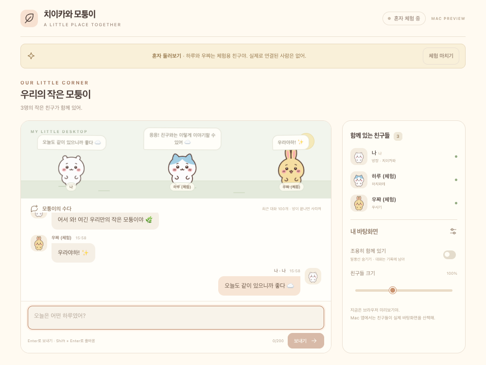

<div align="center">


# 치이카와 모퉁이

**각자의 하루, 같은 모퉁이.**

할 일을 하는 동안에도, 좋아하는 친구들은 곁에.<br />
Mac 바탕화면 구석을 산책하는 작은 친구들과 말풍선으로 수다 떨어요.

<a href="https://github.com/pilgrim13/chiikawa-corner/releases/latest/download/Chiikawa-Corner-mac.dmg"></a>

<sub>macOS 13 이상 · 회원가입 없이 · 앱 하나만 설치</sub>

[새 소식](https://github.com/pilgrim13/chiikawa-corner/releases) · [불편한 점 알려주기](https://github.com/pilgrim13/chiikawa-corner/issues)

</div>

<p align="center"><br /><sub>하루와 우쨔가 기다리는 작은 모퉁이. 화면 속 친구들은 체험용이에요.</sub></p>

### 우리, 같이 있을까요?

1. **앱을 데려와요.** 위에서 내려받은 DMG를 열고, **Chiikawa Corner**를 **Applications**로 끌어 놓아요.
2. **오늘의 나를 골라요.** 닉네임과 캐릭터를 정하고 **우리 방 만들기**를 눌러요. 치이카와·하치와레·우사기 중 누구든 좋아요.
3. **친구에게 문을 열어요.** **친구 초대**로 복사한 초대장을 보내요. 친구는 **초대받았어요**에 붙여넣고, 방장은 **들어와!**를 누르면 만날 수 있어요.

한 방에 최대 **8명**. **창 접고 바탕화면에서 만나기**를 누르면 작은 친구들만 남아요.<br />
대화창은 캐릭터를 누르거나 **⌘⇧Space**로 다시 열어요. 아직 혼자라면 **먼저 혼자 둘러보기**부터!

### 새 버전도 가볍게

앱 오른쪽 위 **업데이트 → 업데이트 확인 → 업데이트 다운로드 → 재시작하고 적용** 순서로 눌러요.<br />
다운로드가 끝나도 바로 꺼지지 않아요. 준비됐을 때 재시작하면 돼요.

### 작은 궁금증

<details>
<summary><b>0.1.0을 이미 쓰고 있어요.</b></summary>

0.1.0에는 앱 안의 업데이트 기능이 없어요. **이번 한 번은 위 DMG를 내려받아 Applications의 기존 앱을 교체**해 주세요. 이후에는 앱의 **업데이트** 버튼을 사용하면 돼요.

</details>

<details>
<summary><b>Mac에서 처음 열 때 막혀요.</b></summary>

아직 Apple 개발자 인증·공증을 받지 않은 프로토타입이에요. 이 저장소에서 받은 파일이 맞는지 확인한 뒤, **시스템 설정 → 개인정보 보호 및 보안 → 그래도 열기**로 앱 하나를 허용할 수 있어요. [Apple 안내](https://support.apple.com/ko-kr/102445)

</details>

<details>
<summary><b>내 컴퓨터에서도 되나요?</b></summary>

**macOS 13 이상**의 Apple Silicon·Intel용 실행 파일을 함께 담았어요. 실제 실행은 Apple Silicon에서 확인했고, Intel Mac 실물 테스트와 Windows 버전은 아직 준비 중이에요.

</details>

<details>
<summary><b>친구 방에 연결되지 않아요.</b></summary>

지금 채팅 서버는 개발자의 집 Mac에서 돌아가요. 그 Mac이나 서버 연결이 쉬는 동안에는 친구 방에 접속하지 못할 수 있어요. **혼자 둘러보기**는 계속 사용할 수 있어요.

방과 대화는 임시로 머물러요. 최근 대화 100개만 보관하고, 방이 종료되거나 서버가 재시작되면 사라져요.

</details>

<details>
<summary><b>직접 만들어 보고 싶어요.</b></summary>

Electron · React · TypeScript · Socket.IO로 만들었어요.

```sh
npm ci
npm run build
npm start
```

서버 실행, 검증, Mac 패키징과 업데이트 배포 절차는 [개발 안내](docs/DEVELOPMENT.md)에 있어요.

</details>

<p align="center"><sub>귀여운 건 같이 보면 더 귀여우니까. 🌿<br />친구들과 함께 쓰려고 만든 비공식 팬메이드 프로토타입이에요.</sub></p>
